<div align = center>

# [BlueDisplay](https://github.com/ArminJo/Arduino-BlueDisplay)
This library enables an Android smartphone / tablet to act as a graphical display for your Arduino or ESP32.<br/>

[](https://www.gnu.org/licenses/gpl-3.0)
 &nbsp; &nbsp;
[](https://github.com/ArminJo/Arduino-BlueDisplay/releases/latest)
 &nbsp; &nbsp;
[](https://github.com/ArminJo/Arduino-BlueDisplay/commits/master)
 &nbsp; &nbsp;
[](https://github.com/ArminJo/Arduino-BlueDisplay/actions)
 &nbsp; &nbsp;

<br/>
<br/>
[](https://stand-with-ukraine.pp.ua)

Available as [Arduino library "BlueDisplay"](https://www.arduinolibraries.info/libraries/blue-display). Requires the [Open Source](https://github.com/ArminJo/android-blue-display) Android [BlueDisplay app](https://play.google.com/store/apps/details?id=de.joachimsmeyer.android.bluedisplay).

[](https://www.ardu-badge.com/BlueDisplay)
 &nbsp; &nbsp;
[](https://github.com/ArminJo/Arduino-BlueDisplay?tab=readme-ov-file#revision-history)

</div>

#### If you find this library useful, please give it a star.

&#x1F30E; [Google Translate](https://translate.google.com/translate?sl=en&u=https://github.com/ArminJo/Arduino-BlueDisplay)

<br/>


# BlueDisplay library for Arduino
With the BlueDisplay library you create the GUI for your application, e.g. **Graphics, Text, Buttons, Sliders and Charts** on the Arduino itself.<br/>
**No Android programming required!**<br/>
The Arduino is **connected via USB-cable or Bluetooth** with your smartphone / tablet, where the BlueDisplay app renders the GUI.
**GUI callback, touch and sensor events** are sent back to the Arduino, where they can be handled.<br/>
The Bluetooth connection can be achieved by using an **ESP32** or connecting an **HC-05** to the RX/TX pins of your Arduino.
Connecting the Arduino with a USB cable to your smartphone requires a USB-OTG adapter.<br/>

<br/>

# Table of contents
- [Features](#features)
  - [Local graphic support](#local-graphic-support)
- [Installation](#installation)
  - [Bluetooth with an HC-05 module](#bluetooth-with-an-hc-05-module)
  - [Bluetooth with an ESP32](#bluetooth-with-an-esp32)
  - [USB cable](#usb-cable)
  - [Supported boards](#supported-boards)
- [Usage](#usage)
  - [Which Serial interface?](#which-serial-interface)
- [Sensor axes for an Arduino application](#sensor-axes-for-an-arduino-application)
- [Lines and anti-aliasing](#lines-and-anti-aliasing)
- [Including the library with .hpp and .h files](#including-the-library-with-hpp-and-h-files)
- [Compile options / macros for this library](#compile-options--macros-for-this-library)
- [Display Unicode characters with `setCharacterMapping()`](#display-unicode-characters-with-setcharactermapping)
- [Using another Codepage with `setCodePage()`](#using-another-codepage-with-setcodepage)
- [Element positioning](#element-positioning)
  - [Text](#text)
  - [Button and Slider](#button-and-slider)
  - [Charts](#charts)
  - [Text position before version 5.0](#text-position-before-version-50)
- [Special color values](#special-color-values)
- [Examples](#examples)
  - [BlueDisplayBlink](#bluedisplayblink)
  - [BlueDisplayExample](#bluedisplayexample)
  - [ManySlidersAndButtons](#manyslidersandbuttons)
  - [ChartDemo](#chartdemo)
  - [ChartForMHZ19_CO2](#chartformhz19_co2)
  - [UltimateBatteryTester](#ultimatebatterytester)
  - [TouchGuiDemo](#touchguidemo)
  - [ShowSensorValues](#showsensorvalues)
  - [BTModuleProgrammer](#btmoduleprogrammer)
  - [RcCarControl](#rccarcontrol)
  - [ServoExample](#servoexample)
  - [SimpleDSO_BlueDisplay](#simpledso_bluedisplay)
  - [SimpleTouchScreenDSO](#simpletouchscreendso)
  - [TwoButtonsOnLocalDisplay](#twobuttonsonlocaldisplay)
  - [US_Distance](#us_distance)
- [Random delays on some smartphones](#random-delays-on-some-smartphones)
- [Extras](#extras)
- [Hints](#hints)
  - [Opening the app's menu](#opening-the-apps-menu)
  - [Debugging](#debugging)
- [Revision History](#revision-history)
- [Old Revision History](#old-revision-history-corresponding-to-the-android-bluedisplay-app)
- [CI](#ci)
- [Requests for modifications / extensions](#requests-for-modifications--extensions)

<br/>

# Features
- **Graphic + text** output as well as **printf implementation**.
- **Touch button + slider** objects with tone feedback and 16 bit values.
- Draw **chart** from byte or short values. Enables clearing of last drawn chart.
- **Voice output** with Android TextToSpeech for Android > 5.0 (Lollipop).
- **Touch and sensor events** are sent to Arduino.
- Automatic and manual **scaling of display region**.
- Sliders can have arbitrary start and end values.
- Buttons can be **Red/Green toggle** button with different text for both states.
- Buttons can be **autorepeat buttons** with 2 different repeat rates.
- Easy mapping of any UTF-8 characters like Ohm, Celsius etc.
- Up to **115200 Baud** using **HC-05** modules or **USB OTG**.
- **USB OTG connection** can be used instead of Bluetooth.
- Local display of received and sent commands for debugging purposes.
- Hex and ASCII output of received Bluetooth data at **log level** verbose.
- **Debug messages as toasts**.

## Local graphic support
- [Thick line](https://github.com/ArminJo/Arduino-BlueDisplay/blob/master/src/LocalGUI/ThickLine.hpp) with Bresenham.
- Touch button + slider implementations for HX8347D and SSD1289 controllers.
- Local event support for ADS7846 resistive touch controller.
- Local and remote displays can be used simultaneously and are synchronized when possible.

<br/>

# Installation
1. **Arduino library:** In the Arduino IDE, open *Tools > Manage Libraries...*, search for "BlueDisplay" and install it.
2. **Android app:** Install the [BlueDisplay app](https://play.google.com/store/apps/details?id=de.joachimsmeyer.android.bluedisplay) on your smartphone / tablet.
3. **Connection:** Connect your board to the smartphone / tablet as described below.
4. **First test:** Upload the [BlueDisplayBlink](#bluedisplayblink) example, start the app and connect to your board.
You should see a blinking circle and a Start / Stop button.

## Bluetooth with an HC-05 module
- Connect **Arduino TX to HC-05 RXD**, **Arduino RX to HC-05 TXD** (see [Connecting Arduino RX](#connecting-arduino-rx)) and connect VCC and GND. See the [breadboard layout](extras/BlueDisplayBlink_Steckplatine.png).
- Pair the module with your device in the Android Bluetooth settings.
- HC-05 modules usually run at 9600 baud. To use another baud rate, see [BLUETOOTH_BAUD_RATE](#compile-options--macros-for-this-library) and [BTModuleProgrammer](#btmoduleprogrammer).

### Connecting Arduino RX
To enable programming of the Arduino while the HC-05 module is connected, use a Schottky diode
(e.g. a BAT 42) to connect **Arduino RX and HC-05 TX**.
On Arduino MEGA 2560, TX1 is used, so no diode is needed.
```
                 |\ |
   Arduino-rx ___| \|___ HC-05-tx
                 | /|
                 |/ |
```

## Bluetooth with an ESP32
No additional hardware is required.
Use `initSerial("My-ESP32")` in your program and pair your device with this name.
For ESP32 no baud rate must be specified.

## USB cable
Connect the board to your smartphone / tablet using a USB-OTG adapter.
On boards which use Serial1 for BlueDisplay, you must also activate the macro [`BD_USE_USB_SERIAL`](#compile-options--macros-for-this-library).

## Supported boards
| Board | Connection | Serial object used |
|-|-|-|
| ATmega328 boards, e.g. Uno and Nano | HC-05 or USB | `Serial` |
| AVR boards with a second USART, e.g. Mega 2560 and Leonardo | HC-05 or USB | `Serial1`, or `Serial` with `BD_USE_USB_SERIAL` |
| STM32, e.g. BluePill | HC-05 or USB | `Serial1` if available, otherwise `Serial` |
| ESP32 | Built-in Bluetooth | `SerialBT` |
| ESP8266, Arduino Due | External Bluetooth module, e.g. HC-05 | `Serial` |

<br/>

# Usage
This program shows a button which switches the LED on and off.

```c++
//#define BLUETOOTH_BAUD_RATE BAUD_115200 // Activate this, if you have reprogrammed the HC-05 module for 115200, otherwise 9600 is used as baud rate
#include "BlueDisplay.hpp"

BDButton TouchButtonLED;

// Callback handlers for (re)connect, resize and button touch
void initDisplay(void);
void drawGui(void);
void handleLEDButton(BDButton *aTheTouchedButton, int16_t aValue);

void setup() {
    pinMode(LED_BUILTIN, OUTPUT);
    initSerial(); // On ESP32 use initSerial("My-ESP32") instead. This is the name you pair your phone with.
    BlueDisplay1.initCommunication(&Serial, &initDisplay, &drawGui); // Introduces up to 1.5 seconds delay. Calls initDisplay() and drawGui(), if a connection is available
}

void loop() {
    // Your application code here. Do not block for long, because events are only handled by the next line
    checkAndHandleEvents(); // Handles events and detects a later (re)connect
}

// Called on each (re)connect. Define the display size and create all GUI elements here. Nothing is drawn yet.
void initDisplay(void) {
    BlueDisplay1.setFlagsAndSize(BD_FLAG_FIRST_RESET_ALL | BD_FLAG_USE_MAX_SIZE | BD_FLAG_TOUCH_BASIC_DISABLE | BD_FLAG_SCREEN_ORIENTATION_LOCK_SENSOR_LANDSCAPE, 320, 240);
    TouchButtonLED.init(100, 100, 120, 40, COLOR16_BLUE, "LED off", TEXT_SIZE_22, FLAG_BUTTON_DO_BEEP_ON_TOUCH | FLAG_BUTTON_TYPE_TOGGLE, false, &handleLEDButton);
    TouchButtonLED.setTextForValueTrue("LED on");
    BlueDisplay1.speakStringBlockingWait(F("Display ready")); // Maximum 32 characters supported for F("")
}

// Called on each (re)connect and resize. Draw the whole GUI here.
void drawGui(void) {
    BlueDisplay1.clearDisplay(COLOR16_WHITE);
    TouchButtonLED.drawButton();
}

// Called when the button is touched. For a toggle button, aValue is the new state.
void handleLEDButton(BDButton *aTheTouchedButton __attribute__((unused)), int16_t aValue) {
    digitalWrite(LED_BUILTIN, aValue);
}
```

- `initDisplay()` is called on each (re)connect. Define the display size and create all GUI elements here.
- `drawGui()` is called after `initDisplay()` and on each resize. Clear the display and draw all GUI elements here.
- `checkAndHandleEvents()` must be called regularly in `loop()`. It calls the callback functions when events are received and detects a connection established after `setup()`.

<br/>

## Which Serial interface?
Boards with a second USART, such as the Mega 2560, use **Serial1** for the BT connection. This leaves Serial, which is mostly connected to USB, free for other purposes such as logging.
ATmega328 boards, such as the Uno and Nano, always use Serial. See [Supported boards](#supported-boards) for all platforms.<br/>
If you require a **direct USB connection** to the smartphone / tablet by cable on a board which uses Serial1, you must activate the macro [`BD_USE_USB_SERIAL`](#compile-options--macros-for-this-library).<br/>
Another, but more complicated, way is **to modify the central serial interface function of the library**.
You only have to change the first 2 lines of the function `sendUSARTBufferNoSizeCheck()` in [BlueSerial.hpp](src/BlueSerial.hpp) according to your requirements.

<br/>

# Sensor axes for an Arduino application
Android axes are [defined for **natural screen orientation**](https://source.android.com/devices/sensors/sensor-types), which is portrait for my devices:
- When the device lies flat on a table and its left side is down and right side is up or pushed on its left side toward the right, the X acceleration value is positive.
- When the device lies flat on a table and its bottom side is down and top side is up or pushed on its bottom side toward the top, the Y acceleration value is positive.
- When the device lies flat on a table, the acceleration value along Z is +9.81 (m/s^2).

**The BlueDisplay application converts the axes, so that this definition holds for each screen orientation.**
For detailed information about sensors, see the [ShowSensorValues example](https://github.com/ArminJo/Arduino-BlueDisplay/blob/master/examples/ShowSensorValues/ShowSensorValues.ino).

<br/>

# Lines and anti-aliasing
Lines and vectors that are not horizontal or vertical are drawn with anti-aliasing.
This has the disadvantage that these lines cannot be removed without residual by overwriting them with background color.
You must use the *WithAliasing() function variant if you have a diagonal line or vector that you want to remove by overwriting.

<br/>

# Including the library with .hpp and .h files
In order to support [compile options](#compile-options--macros-for-this-library) more easily,
you **must** use `#include <BlueDisplay.hpp>` in your main program (the *.ino file with setup() and loop()).

In **all other files**, where you need the definitions, you must use `#include <BlueDisplay.h>`, to **prevent `multiple definitions` linker errors**.

<br/>

# Compile options / macros for this library
To customize the library to different requirements, there are some compile options / macros available.<br/>
These macros must be defined in your program **before** the line `#include <BlueDisplay.hpp>` to take effect.<br/>
Modify them by enabling / disabling them, or change the values if applicable.

| Name | Default value | Description |
|-|-:|-|
| `BLUETOOTH_BAUD_RATE` | 9600 | Change this, if you have [reprogrammed](#btmoduleprogrammer) the HC-05 module for another baud rate e.g. 115200. If it is not defined, `initSerial()` uses 9600. |
| `DO_NOT_NEED_BASIC_TOUCH_EVENTS` | disabled | Disables basic touch events down, move and up. Saves up to 170 bytes program memory and 14 bytes RAM. |
| `DO_NOT_NEED_LONG_TOUCH_DOWN_AND_SWIPE_EVENTS` | disabled | Disables LongTouchDown and SwipeEnd events. Saves up to 88 bytes program memory and 4 bytes RAM. |
| `DO_NOT_NEED_SPEAK_EVENTS` | disabled | Disables SpeakingDone event handling. Saves up to 54 bytes program memory and 18 bytes RAM. |
| `ONLY_CONNECT_EVENT_REQUIRED` | disabled | Disables reorientation, redraw and sensor-change events. Saves up to 50 bytes program memory and 4 bytes RAM. |
| `BD_USE_SIMPLE_SERIAL` | disabled | Only for AVR! Do not use the Serial object. Saves up to 1250 bytes program memory and 185 bytes RAM, if Serial is not used otherwise. |
| `BD_USE_USB_SERIAL` | disabled | Activate it, if you want to force using **Serial** instead of **Serial1** for **direct USB cable connection** to your smartphone / tablet. This is only required on platforms, which have Serial1 available. |
| `SUPPORT_LOCAL_DISPLAY` | disabled | Supports simultaneously drawing on the locally attached display. Not (yet) implemented for all commands! |
| `DISABLE_REMOTE_DISPLAY` | disabled | Suppress drawing to Bluetooth connected display. Allow only drawing on the locally attached display. Requires `SUPPORT_LOCAL_DISPLAY`. Not (yet) implemented for all commands! |
| `ALLOW_BD_DEPRECATED_FUNCTIONS` | disabled | Deprecated functions are omitted by default since version 5.2.0. Activate it, if your program still uses them. |
| `LOCAL_GUI_FEEDBACK_TONE_PIN` | disabled | If defined, local GUI library calls `tone(LOCAL_GUI_FEEDBACK_TONE_PIN, 3000, 50)` on flags like FLAG_BUTTON_DO_BEEP_ON_TOUCH. |
| `SUPPORT_ONLY_TEXT_SIZE_11_AND_22` | disabled | If defined, saves program memory especially for local GUI. |
| `LOCAL_DISPLAY_HEIGHT` | 240 | The height of the local display used by the LocalGUI library. |
| `LOCAL_DISPLAY_WIDTH` | 320 | The width of the local display used by the LocalGUI library. |

<br/>

# Display Unicode characters with `setCharacterMapping()`
If we want to display special characters, we face the problem that we can only send single byte character codes. But fortunately ASCII only defines the codes up to 0x7F, which leaves the 128 upper character codes between 0x80 and 0xFF, normally used for the local codepage.<br/>
But with `setCharacterMapping(<ASCII_value>, <UTF16_value>)` you can modify this codepage, i.e. display the character <UTF16_value> if you send <ASCII_value>, which has to be between 0x80 and 0xFF.<br/>
Since the second parameter for setCharacterMapping is 16 bit, you cannot use characters whose Unicode code is higher than 0xFFFF like the electric light bulb (U+1F4A1 from https://www.fileformat.info/info/unicode/char/1f4a1/index.htm).

### Example

``` c++
    BlueDisplay1.setCharacterMapping(0x87, 0x2227); // mapping for unicode AND used as Forward symbol
    BlueDisplay1.setCharacterMapping(0x88, 0x2228); // mapping for unicode OR used as Backwards symbol
    BlueDisplay1.setCharacterMapping(0x81, 0x03A9); // Omega in UTF16
    // 0x03A9 is Omega, 0x0394 is Delta, 0x21B2 is Enter, 0x21E7 is Ascending, 0x21E9 is Descending in UTF16
    // 0x2302 is Home, 0x2227 is UP (logical AND), 0x2228 is Down (logical OR), 0x2195 is UP/Down, 0x2103 is Degree Celsius in UTF16
```

<br/>

# Using another Codepage with `setCodePage()`
By default, the local codepage of the Android system is used to display special characters above 0x7F.<br/>
But if you have e.g. an [ISO 8859 codepage](https://en.wikipedia.org/wiki/ISO/IEC_8859) which better fits your needs and you want to use as your default code page, you can change it with `setCodePage(<ISO_8859_Number>)`. Internally it is done on Android with `Charset.forName("ISO_8859_" + <ISO_8859_Number>)`.

<br/>

# Element positioning
## Text
- Text Y position is upper left corner of character
- Text Y bottom position is position + TextSize
- Text Y middle position is position + TextSize / 2

## Button and Slider
- Slider position is upper left corner of slider
- Button position is upper left corner of button

## Charts
- Chart Position X and Y is data origin, which is on rightmost point of Y axis and on uppermost point of X axis

## Text position before version 5.0
This is only relevant for porting old programs.
- Text Y position is baseline of character.
- Text Y top position is (Y position - ascend) - use getTextAscend(TextSize).
- Text Y bottom position is position + descend.
- Text Y middle position is position - ((ascend - descend) / 2) - see getTextMiddleCorrection().
- Text position for local implementation is upper left corner of character.

<br/>

# Special color values
- If the color of a text or button is `COLOR16_NO_BACKGROUND`, no background is rendered for the text or button (text-only button).
- If `aClearBeforeColor` of the `drawChartByteBuffer*()` functions is `COLOR16_NO_DELETE`, the old chart will not be cleared. This is used for the "history" function of the DSO example.

<br/>

# [Examples](examples)
Before using the examples, make sure that the Bluetooth module (e.g. the HC-05 module) or the ESP32 running the example
is paired with your Android device in the Android Bluetooth settings.

Nearly all examples initially use the **baud rate of 9600**. The exceptions are **ManySlidersAndButtons**,
which is set to 115200, and SimpleTouchScreenDSO, which uses a local display and `Serial` at 115200 for its output.<br/>
Especially the SimpleDSO_BlueDisplay example will run smoother with a baud rate of 115200.<br/>
For this, activate the line `#define BLUETOOTH_BAUD_RATE BAUD_115200` in the example and deactivate a `#define BLUETOOTH_BAUD_RATE` line for 9600, if there is one.<br/>
**AND** change the Bluetooth module baud rate, e.g. by using the BTModuleProgrammer.ino example.<br/>
For ESP32 no baud rate must be specified :-).

## BlueDisplayBlink
Simple example to check your installation.
| With debug output as "Toast" after pressing the "Stop" button | Breadboard |
| :-: | :-: |
| 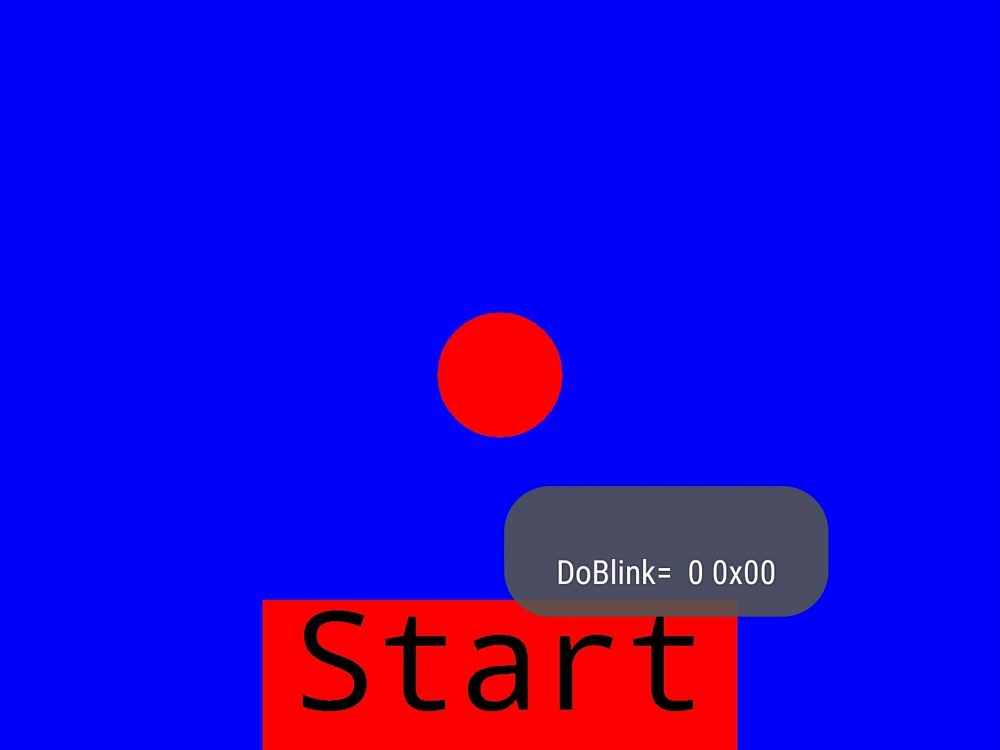 | 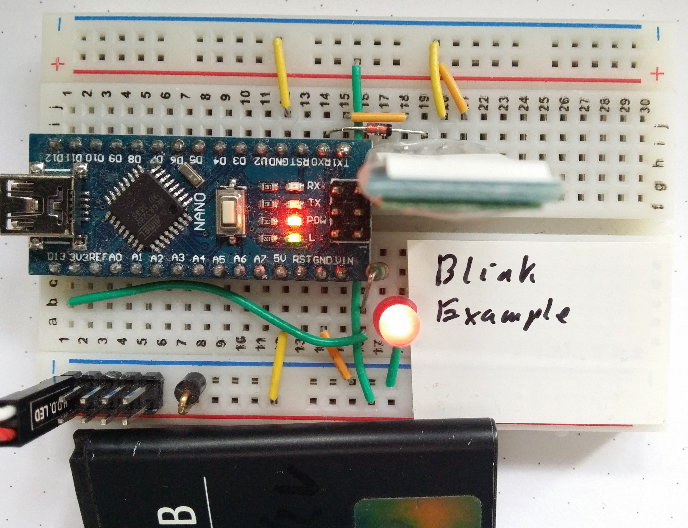 |

<br/>

## BlueDisplayExample
More elaborate example to show more features of the BlueDisplay library.
| Screenshot | Graphics test page with additional thick red lines |
| :-: | :-: |
| 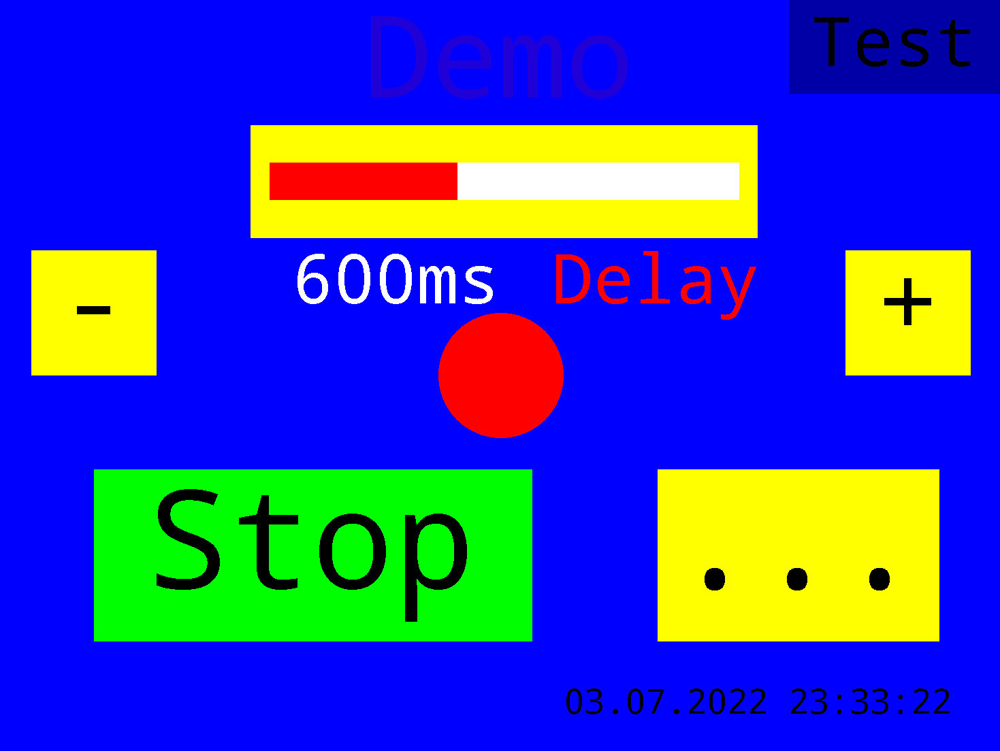 | 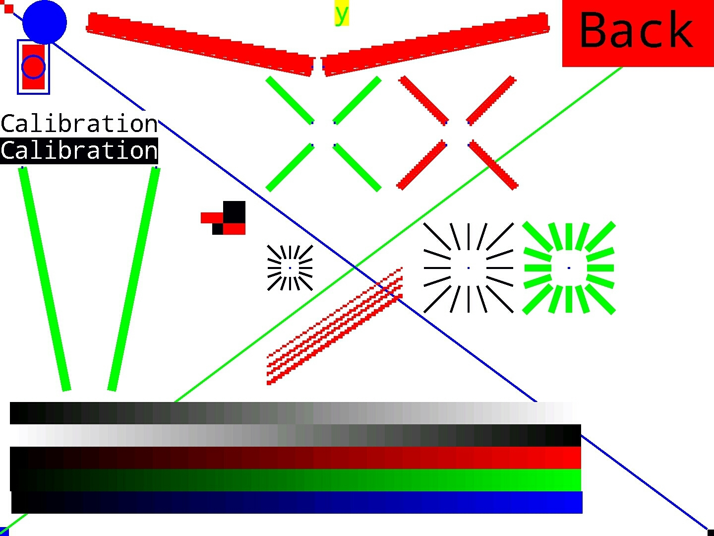 |
| Fritzing schematic for BlueDisplay example | BlueDisplay example breadboard picture |
| 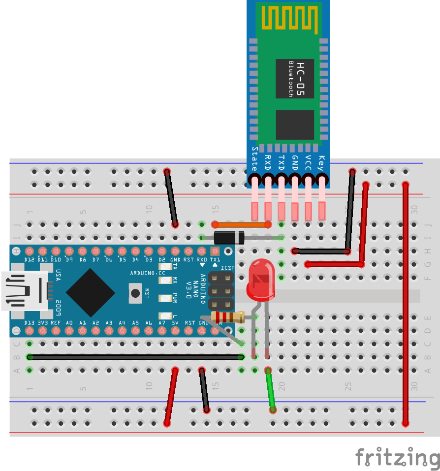 |  |

<br/>

## ManySlidersAndButtons
Example with up to 16 sliders and 6 user buttons to control analog values and functions of an Arduino application.
The number of sliders and buttons is configurable; the sketch is set to 8 + 6 sliders and 6 user buttons.
Additional buttons load and store setups.<br/>
Buttons can be Red/Green toggle buttons. Includes the implementation of a 4 value slider with user provided text value.<br/>
**This example is set to 115200 baud.**
Deactivate the line `#define BLUETOOTH_BAUD_RATE BAUD_115200` if your HC-05 module still uses 9600 baud.
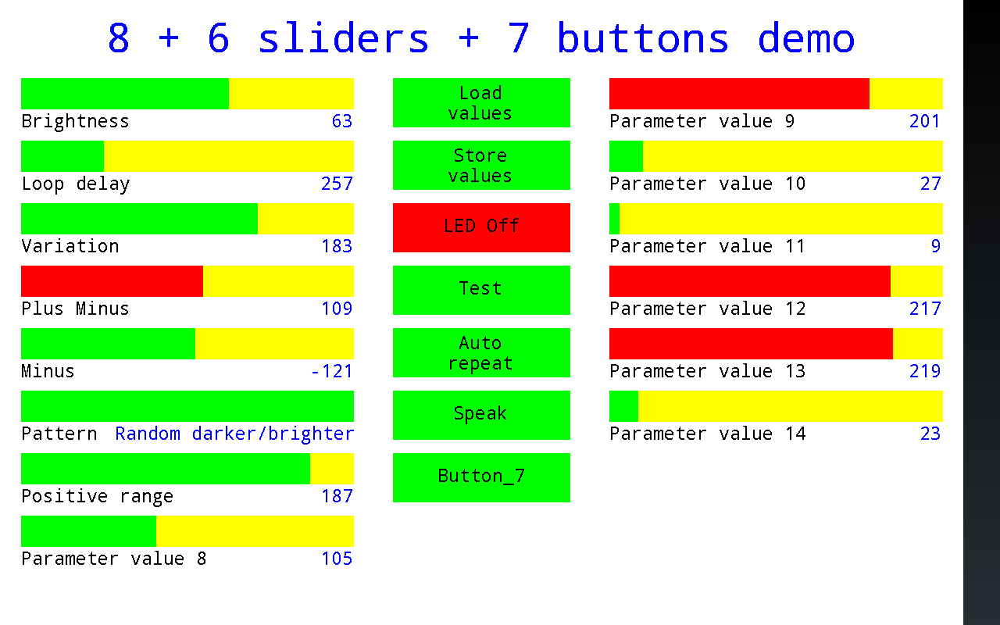

<br/>

## ChartDemo
Shows the features of the BlueDisplay chart with 3 different charts using the function `showChartDemo()`.

<br/>

## ChartForMHZ19_CO2
A full display GUI displaying 4 days of CO2 values with BlueDisplay chart.
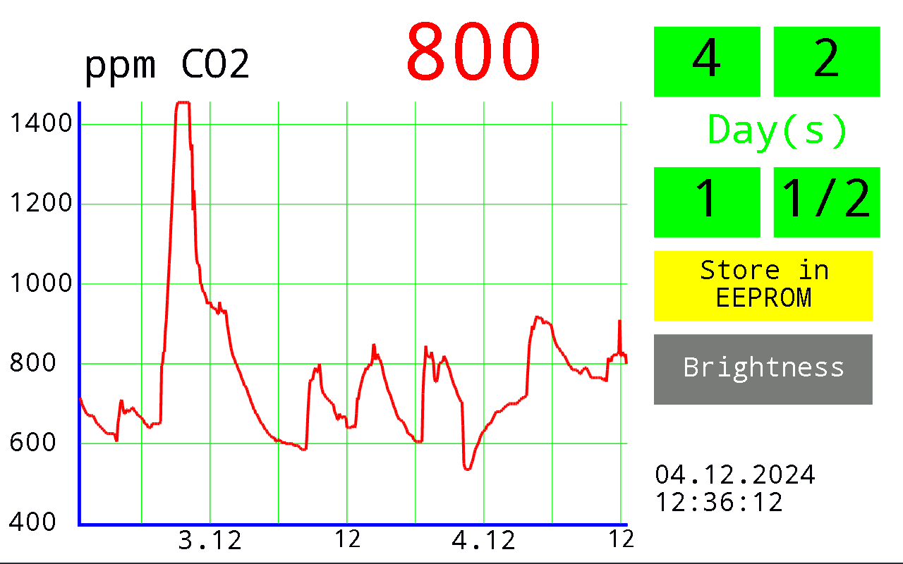

<br/>

## UltimateBatteryTester
This is not part of this library, but an external project using it.
Screenshot from the [Ultimate-Battery-Tester example running in BlueDisplay mode](https://github.com/ArminJo/Ultimate-Battery-Tester?tab=readme-ov-file#features).


<br/>

## TouchGuiDemo
Demo of the GUI: LocalTouchButton, LocalTouchSlider and Chart as well as the programs Game of Life and Draw Lines.<br/>
If a local display is attached, two additional pages, show font and ADS7846 A/D channels are enabled.
| TouchGuiDemo main page | Chart page |
| :-: | :-: |
| 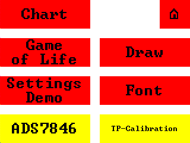 | 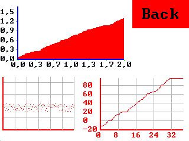 |
| Game Of Life start page | Game Of Life page |
| 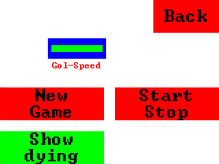 | 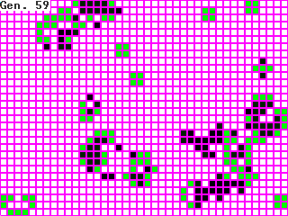 |
| Draw page | Settings page |
| 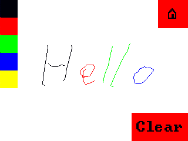 | 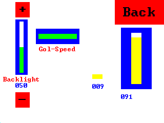 |

<br/>

## ShowSensorValues
Shows the accelerometer and gyroscope values received from the smartphone both graphically and numerically.

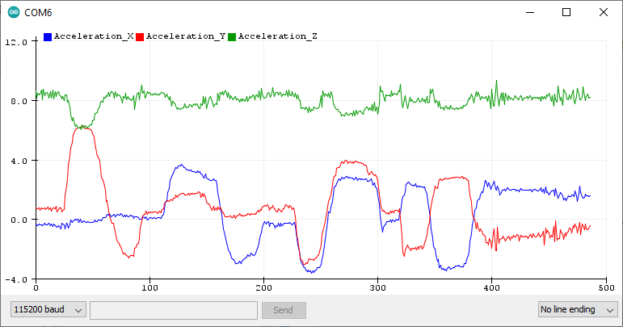

<br/>

## BTModuleProgrammer
Simple helper program to configure your HC-05 or JDY-31 module's name and default baud rate with a serial monitor.
It can also be used to enter AT commands directly to the BT module for extended manual programming.<br/>
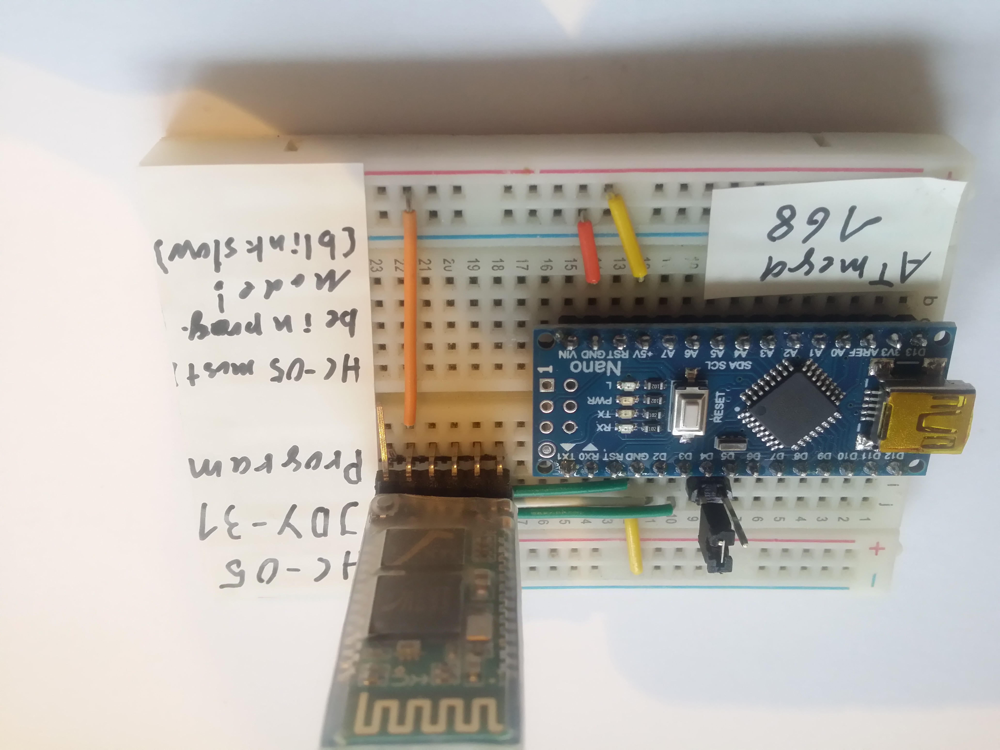

Sample outputs can be found [here](https://github.com/ArminJo/Arduino-BlueDisplay/tree/master/examples/BTModuleProgrammer).

<br/>

## RcCarControl
Example of controlling an RC car by smartphone accelerometer sensor.

| RC car control display | Hacked RC car |
| :-: | :-: |
| 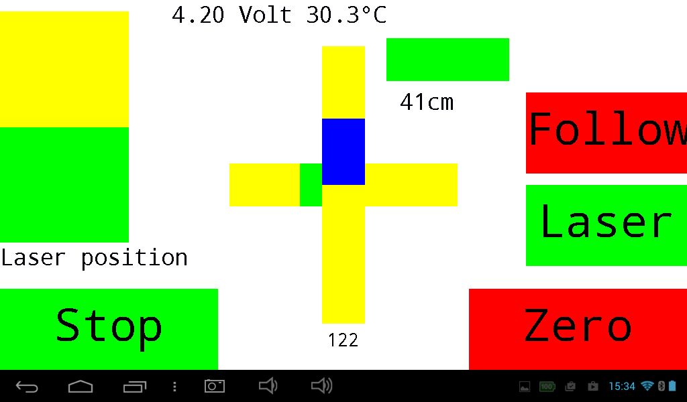 | 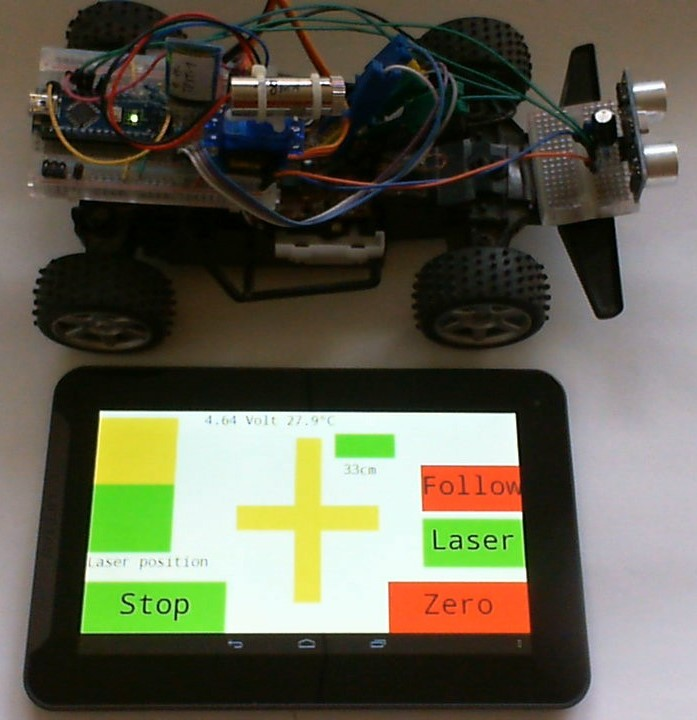 |

<br/>

## ServoExample
The accelerometer sensor of the Android display is used to control two servos in a frame which holds a laser.
This is an example for using a fullscreen GUI.<br/>
If no BD connection is available, the servo first marks the border and then moves randomly in this area (Cat Mover).<br/>
- Zero -> the current sensor position is taken as the servos' 90/90 degree position.
- Bias (reverse of Zero) -> take the current servos' position as the position for the horizontal sensor position.
- Auto move -> moves randomly in the programmed border. Currently horizontal 45 to 135 and vertical 0 to 45.

| Screenshot | Bias setting |
| :-: | :-: |
| 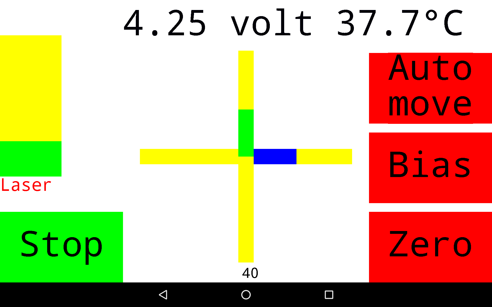 | 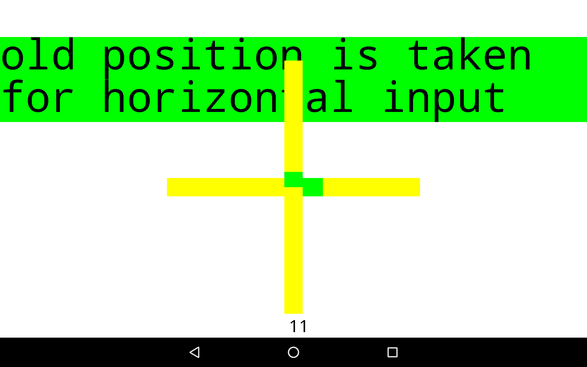 |

<br/>

## **SimpleDSO_BlueDisplay**
300 kSamples DSO without external hardware (except the HC-05 module). For AC input, only a capacitor and 4 resistors are needed.
More information at [Arduino-Simple-DSO](examples/SimpleDSO_BlueDisplay).<br/>
**For AVR only!**
| DSO start screen | DSO chart screen with long info |
| :-: | :-: |
|  |  |

<br/>

## SimpleTouchScreenDSO
The DSO running on a local display, using an Arduino Uno with an mSD-Shield and a MI0283QT-2 adapter.
More information at [SimpleTouchScreenDSO](examples/SimpleTouchScreenDSO).

<br/>

## TwoButtonsOnLocalDisplay
Demo of creating two buttons on a local display using the LocalTouchButton library for Arduino Uno with an mSD-Shield and a MI0283QT adapter.

<br/>

## US_Distance
Shows the distances measured by an HC-SR04 ultrasonic sensor. Can be used as a parking aid.
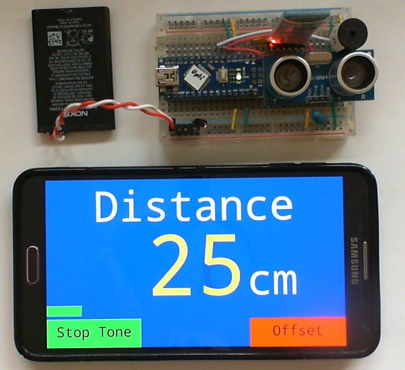

<br/>

# Random delays on some smartphones
Depending on the device you use, you can observe some random **"delays"** of up to 500 ms in the timing of the display refresh.

### What you can do
- Use a **USB connection** instead of Bluetooth. **The delays do not occur** with most devices.
- Send less data. Using a delay of `HELPFUL_DELAY_BETWEEN_DRAWING_CHART_LINES_TO_STABILIZE_BT_CONNECTION` or `HELPFUL_DELAY_BETWEEN_DRAWING_CHART_LINES_TO_STABILIZE_USB_CONNECTION` before or after sending chart values can help.
- Watch the log for the error `RPCView Read delay > 1000ms for missing bytes.`.
It looks like some errors of this kind are tolerable, but if they occur too often, then you should increase the delays between the data sent.

### Why it happens
The Android Bluetooth driver does not return its received bytes for a longer time.<br/>
If you send too much data during this delay, the **driver may hang**, as you can observe for the SimpleDSO application, which runs **smoothly with a USB** connection.<br/>
But I also got this kind of problem with a USB connection with my Samsung SM-T560.<br/>
Hanging may be avoided if using flow control, but the HC05 firmware and HC05 breakout boards do not support it.
And flow control with USB resets the board :-(.
On the ESP32, the BluetoothSerial library supports flow control and there you can observe that the client program also delays, when the smartphone driver takes its break.<br/>
This Bluetooth driver is usually delivered by the hardware vendor, so it may depend on the chips used in your smartphone.
It seems that some Bluetooth SPP (Serial Port Profile) drivers are not really specified/tested/optimized for real time behavior.

### Known devices
Known devices **with** these "delays" are:<br/>
Lenovo K3 Note 6.0, Nexus7 with AW-NH665 BT-Chip running 6.0.1, Nexus 6P with ?8.x?, Kindle Fire HD 8 with Broadcom BCM2076 running 6.3.1.5.<br/>
Known devices **without** these "delays" are:<br/>
Samsung Note 3 running 5.0, Lifetab P9702 running 7.1.2, Lifetab E10310 running 4.2.2, XORO PAD 721 running 4.2.2, Samsung Galaxy S3 GT-I9300 running Lineage 7.1.2, LUX10 running 5.0, iRULU X11 running 5.1.1, Time2 TC1050G running 5.1, Pixel 4 XL running 10.

<br/>

# Extras
The [extras folder](extras) (`libraries/BlueDisplay/extras` in your Arduino sketchbook folder)
contains more schematics, breadboard layouts and pictures which may help you to build the example projects.

The src folder also contains a [list of all available voices](src/TTS-ListOfAllVoices.txt) found on my device, as shown in the startup log at debug level Info.

# Hints
### Opening the app's menu
For full screen applications, the app's menu is called by swiping horizontally from the left edge of the screen.
Otherwise, you can call it by touching the area not occupied by the client application (black display area).

### Debugging
If you need debugging, you can use the `debug()` functions.<br/>
`Serial.print()` will also work on boards where BlueDisplay uses `Serial` like the Uno and Nano :-), see [Supported boards](#supported-boards).<br/>
Keep in mind that a debug message is shown for at least 500 ms, before another one is accepted.

```c++
BlueDisplay1.debug("DoBlink=", doBlink);
```
The debug content will then show up as **toast** for at least 500 ms on your Android device and is stored in the log.
Change the **log level** in the app to see more or less information of the BlueDisplay communication.

# Revision History
### Version 5.2.0
- `OMIT_BD_DEPRECATED_FUNCTIONS` is now enabled by default and can be disabled by `ALLOW_BD_DEPRECATED_FUNCTIONS`.
- New function `setButtonsGlobalTouchToneState()` and `debug(bool ...)`.
- Removed `clearDisplayAndDisableButtonsAndSliders()`, is now included in `.clearDisplay()`. Added `clearDisplayArea()`.
- Changed Tone forever duration parameter value from -1 to 0.
- Added functions `setValueAndDrawSlider()` and `clearDisplayAreaAndSkipCommandsBeforeOnHostBufferOverflow()`.
- Renamed `drawAxesAndGrid()` to `drawAxesAndLabelsAndGrid()`.
- Improved Chart functions.

### Version 5.1.0
- Renamed function names and variables from `GridOrLabelX` to `XGridOrLabel` and `GridOrLabelY` to `YGridOrLabel`.
- Improved `computeXLabelAndXDataScaleFactor()` to support scaling factor 1 and -1.
- Added `drawYAxisTitle(const int aYOffset, const int aXOffset)`.

### Version 5.0.0
- Voice output with Android TextToSpeech for Android > 5.0 (Lollipop).
- Text Y and X position is upper left corner of character.
- Added `setCallback()` and `setFlags()` for buttons and sliders.
- Modified ManySlidersAndButtons example.
- Screen orientation flags now also possible in setFlagsAndSize().
- Increased `STRING_BUFFER_STACK_SIZE` value from 32 to 48.
- Added `delayMillisWithCheckForStartedReceivingAndHandleEvents()` and `checkForStartedReceivingAndHandleEvents()`.

### Version 4.4.0 - The version compatible with app version 4.4
- Removed `mMaxDisplaySize`, because it was just a copy of `CurrentDisplaySize`.
- Renamed `getDisplaySize()` to `getRequestedDisplaySize()` etc.
- Renamed `drawVectorDegrees()` to `drawVectorDegree()`.
- Added functions `draw*WithAliasing()`.
- Added slider function `setMinMaxValue()`.
- Refactored and improved Chart.
- Minor bug fixes.
- Added a full screen example for a log chart of CO2 values.
- Added the convenience function `clearTextArea()`.
- Changed value of `COLOR16_NO_DELETE`.
- Renamed `DO_NOT_NEED_TOUCH_AND_SWIPE_EVENTS` to `DO_NOT_NEED_LONG_TOUCH_DOWN_AND_SWIPE_EVENTS`.
- `BD_FLAG_TOUCH_BASIC_DISABLE` is always set if `DO_NOT_NEED_BASIC_TOUCH_EVENTS` is defined.
- Improved BTModuleProgrammer program.

### Version 4.0.1
- Minor changes and updated third-party libs.

### Version 4.0.0
- Major refactoring, many bug fixes and seamless support of local display.
- All `*Rel*()` functions now have signed delta parameters.
- Fixed bugs in `drawLineRelWithThickness()` and button list for local display.
- Added `debug(const __FlashStringHelper *aStringPtr)`.
- Added `bool delayAndCheckForEvent()`.

### Version 3.0.2
- Added function setPosition() for sliders.
- Fixed bug in macros `BLUE ` and `COLOR32_GET_BLUE`.

### Version 3.0.1
- ADCUtils now external sources.

### Version 3.0.0
- Improved BTModuleProgrammer program.
- Renamed *.cpp to *.hpp.

### Version 2.2.0
- Changed default serial for AVR from `USE_SIMPLE_SERIAL` to standard Arduino Serial.
- Added ShowSensorValues example.
- Renamed mReferenceDisplaySize to mRequestedDisplaySize and renamed related function to getRequestedDisplaySize().
- New function `setBarThresholdDefaultColor`. Requires BlueDisplay app version 4.3.
- New function `setPositiveNegativeSliders(..., aValue, aSliderDeadBand)`.
- Renamed `setPrintf*` functions to `setWriteString*`.
- Switched last 2 parameters in `initCommunication()` and the third parameter is now optional.
- Compatible with MegaCore supported CPUs.

### Version 2.1.1
- New function `setCaptionFromStringArrayPGM()`.
- Added flag `sBDEventJustReceived`.

### Version 2.1.0
- Arduino Due support added.
- New command `FUNCTION_CLEAR_DISPLAY_OPTIONAL` to enable resynchronization of slow displays. Used by SimpleTouchScreenDSO.

### Version 2.0.0
- ESP32 and ESP8266 support added. External BT module required for ESP8266.

### Version 1.3.0
- Added `sMillisOfLastReceivedBDEvent` for user timeout detection.
- Fixed bug in `debug(const char *aMessage, float aFloat)`.
- Added `*LOCK_SENSOR_LANDSCAPE` and `*LOCK_SENSOR_PORTRAIT` in function `setScreenOrientationLock()`. Requires BlueDisplay app version 4.2.
- Removed unused `mCurrentDisplayHeight` and `mCurrentDisplayWidth` member variables.
- Fixed bug in draw function from `drawByte` to `drawLong`.
- Added short `drawText` functions. Requires BlueDisplay app version 4.2.

### Version 1.2.0
- Use type `Print *` instead of `Stream *`.
- New function `initSerial()`
- Changed parameter `aTextSize` to `uint16_t` also for AVR specific functions.

### Version 1.1.0
- Porting to STM32.

### Version 1.0.1
- Changed default baud rate for all examples to `9600`.
- Renamed `USART_send()` to `sendUSART()`.
- DSO example Version 3.1.

### Version 1.0.0
Initial Arduino library version

# Old Revision History corresponding to the Android BlueDisplay App
### V 3.7
- Handling of no input for getNumber.
- Slider setScaleFactor() does not scale the actual value, mostly delivered as initial value at init().

### V 3.6
- connect, reconnect and autoconnect improved/added. Improved debug() command. Simplified Red/Green button handling.

### V 3.5
- Slider scaling changed and unit value added.

### V 3.4
- Timeout for data messages. Get number initial value fixed.
- Bug autorepeat button in conjunction with UseUpEventForButtons fixed.

### V 3.3
- Fixed silent tone bug for Android Lollipop and other bugs. Multiline text \r \n handling.
- Android time accessible on Arduino. Debug messages as toasts. Changed create button.
- Slider values scalable. GUI multi-touch. Hex and ASCII output of received Bluetooth data at log level verbose.

### V 3.2
- Improved tone and fullscreen handling. Internal refactoring. Bugfixes and minor improvements.

### V 3.1
- Local display of received and sent commands for debug purposes.

### V 3.0
- Android sensor accessible by Arduino.

# CI
The library examples are tested with GitHub Actions for the following boards:

- arduino:avr:uno
- arduino:avr:leonardo
- arduino:avr:mega
- arduino:sam:arduino_due_x
- MegaCore:avr:128
- esp8266:esp8266:huzzah:eesz=4M3M,xtal=80
- esp32:esp32:esp32doit-devkit-v1
- STMicroelectronics:stm32:GenF1:pnum=BLUEPILL_F103C8
- stm32duino:STM32F1:genericSTM32F103C

# Requests for modifications / extensions
If you need a modification or an extension, please [open an issue](https://github.com/ArminJo/Arduino-BlueDisplay/issues) including your motivation / problem.
